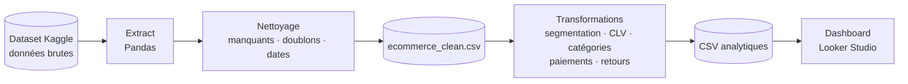

# E-commerce ETL & Dashboard : de la donnée brute à la décision

> Un pipeline **ETL complet** en Python (Pandas) qui nettoie un jeu de données e-commerce brut, calcule la **segmentation client** et la **CLV**, puis alimente un **dashboard interactif** Looker Studio.


## En bref

| | |
|---|---|
| **Objectif** | Transformer des données e-commerce brutes en indicateurs exploitables pour la prise de décision |
| **Données** | Dataset e-commerce public issu de Kaggle ([nom du dataset et nombre de lignes à compléter]) |
| **Pipeline** | Extraction → nettoyage → transformation → export CSV → visualisation |
| **Analyses** | Segmentation client, CLV, catégories de produits, moyens de paiement, retours clients |
| **Livrable** | Notebook Jupyter + CSV analytiques + dashboard Looker Studio |
| **Contexte** |  projet personnel 

## Ce que le projet démontre

- **Pipeline ETL de bout en bout** : de la donnée brute au dashboard, chaque étape est reproductible dans un notebook.
- **Qualité des données** : valeurs manquantes, doublons et dates traités avant toute analyse.
- **Analyse orientée métier** : segmentation client (Low / Mid / High Value) et calcul de la Customer Lifetime Value.
- **Data storytelling** : des résultats analytiques traduits en dashboard interactif pour un public non technique.
- **Esprit d'ouverture** : base prête à être enrichie par du Machine Learning (prédiction des ventes, scoring client).

## Architecture du pipeline



Chaque étape produit un fichier intermédiaire : on peut donc vérifier les données à chaque stade du pipeline.

## Étapes du projet

### 1. Chargement et nettoyage
- Import des données brutes avec Pandas
- Gestion des valeurs manquantes
- Suppression des doublons
- Conversion des dates
- Export du fichier nettoyé : `ecommerce_clean.csv`

### 2. Analyses et transformations

| Analyse | Détail | 
|---|---|---|
| Segmentation client | Clients classés en Low / Mid / High Value | 
| Customer Lifetime Value | CLV par client   |
| Catégories de produits | Performance par catégorie | 
| Moyens de paiement | Répartition et revenus par méthode | 
| Retours clients | Analyse des retours | 

### 3. Dashboard Looker Studio
Un dashboard interactif pour suivre :
- les **KPI clés** : chiffre d'affaires, transactions, retours, CLV
- la **segmentation client**
- la **répartition des transactions par catégorie** de produits
- les **revenus par moyen de paiement**

## Aperçu du dashboard

📷 [Ajouter une capture : ``]


## Résultats et enseignements

> À compléter avec **tes vrais chiffres**, c'est ce qui rend le projet crédible.

- Lignes avant / après nettoyage : **[X] → [Y]** ([Z] doublons supprimés)
- Chiffre d'affaires total : **[valeur]**
- Répartition des clients : **[X % Low · Y % Mid · Z % High Value]**
- Catégorie la plus rentable : **[nom]**
- Moyen de paiement dominant : **[nom, X %]**
- Taux de retour : **[X %]**

## Démarrage rapide

Prérequis : Python 3 et Jupyter.

```bash
git clone [URL du dépôt]
cd E-commerce-etl-dashboard
pip install pandas jupyter
jupyter notebook
```

Ouvrir le notebook `[nom du notebook].ipynb` et exécuter les cellules dans l'ordre. Les CSV sont générés dans `[dossier de sortie]`, puis importés dans Looker Studio.

## Structure du projet

```
├── data/
│   ├── [fichier brut]           # données brutes (Kaggle)
│   └── ecommerce_clean.csv      # données nettoyées
├── [notebook].ipynb             # pipeline ETL et analyses
├── outputs/
│   ├── customer_segmentation.csv
│   ├── product_category_analysis.csv
│   └── ...                      # autres CSV analytiques
├── images/                      # captures du dashboard
└── README.md
```
*(À adapter à ton arborescence réelle.)*

## Compétences mises en œuvre

`Python` · `Pandas` · `ETL` · `Data Cleaning` · `Jupyter Notebook` · `Data Analysis` · `Segmentation client` · `Customer Lifetime Value` · `Looker Studio` · `Data Visualization` · `KPI` · `E-commerce Analytics`

## Limites et pistes d'amélioration

- Le pipeline est lancé **manuellement** depuis un notebook. Piste : le transformer en script Python planifié (cron, Airflow) pour automatiser les mises à jour.
- Les données sont **exportées en CSV** puis importées dans Looker Studio. Piste : les charger dans une base (PostgreSQL, BigQuery) pour un dashboard toujours à jour.
- La segmentation repose sur des **seuils définis à la main**. Piste : la remplacer par un clustering (**K-Means**, analyse **RFM**).
- Piste suivante : modèles de **Machine Learning** pour la prédiction des ventes, du churn et le scoring client.

## Auteur

**Adama Fall** · [LinkedIn / email à ajouter]
