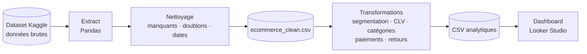

# E-commerce ETL & Dashboard : de la donnée brute à la décision

> Un pipeline **ETL complet** en Python (Pandas) qui nettoie un jeu de données e-commerce brut, calcule la **segmentation client** et la **CLV**, puis alimente un **dashboard interactif** Looker Studio.

## En bref

| | |
|---|---|
| **Objectif** | Transformer des données e-commerce brutes en indicateurs exploitables pour la prise de décision |
| **Données** | Dataset e-commerce public issu de Kaggle |
| **Pipeline** | Extraction → nettoyage → transformation → export CSV → visualisation |
| **Analyses** | Segmentation client, CLV, catégories de produits, moyens de paiement, retours clients |
| **Livrable** | Notebook Jupyter + CSV analytiques + dashboard Looker Studio |

## Ce que le projet démontre

- **Pipeline ETL de bout en bout** : de la donnée brute au dashboard, chaque étape est reproductible dans un notebook.
- **Qualité des données** : valeurs manquantes, doublons et dates traités avant toute analyse.
- **Analyse orientée métier** : segmentation client (Low / Mid / High Value) et calcul de la Customer Lifetime Value.
- **Data storytelling** : des résultats analytiques traduits en dashboard interactif pour un public non technique.
- **Esprit d'ouverture** : base prête à être enrichie par du Machine Learning (prédiction des ventes, scoring client).

## Architecture du pipeline

Chaque étape produit un fichier intermédiaire : on peut donc vérifier les données à chaque stade du pipeline.

## Étapes du projet

### 1. Chargement et nettoyage
- Import des données brutes avec Pandas
- Gestion des valeurs manquantes
- Suppression des doublons
- Conversion des dates
- Export du fichier nettoyé : `ecommerce_clean.csv`

### 2. Analyses et transformations
- Segmentation client (Low / Mid / High Value) → `customer_segmentation.csv`
- Calcul de la Customer Lifetime Value (CLV)
- Analyse par catégorie de produits → `product_category_analysis.csv`
- Analyse des méthodes de paiement
- Étude des retours clients
- Export des résultats dans plusieurs fichiers CSV

### 3. Dashboard Looker Studio
Un dashboard interactif pour suivre :
- les **KPI clés** : chiffre d'affaires, transactions, retours, CLV
- la **segmentation client**
- la **répartition des transactions par catégorie** de produits
- les **revenus par moyen de paiement**

## Compétences mises en œuvre

`Python` · `Pandas` · `ETL` · `Data Cleaning` · `Jupyter Notebook` · `Data Analysis` · `Segmentation client` · `Customer Lifetime Value` · `Looker Studio` · `Data Visualization` · `KPI` · `E-commerce Analytics`

## Limites et pistes d'amélioration

- Le pipeline s'exécute depuis un notebook. Piste : le transformer en script planifié pour automatiser les mises à jour.
- Les résultats passent par des CSV. Piste : les charger dans une base de données pour un dashboard toujours à jour.
- Piste suivante : enrichir avec du **Machine Learning** pour la prédiction des ventes et le scoring client.

## Auteur

**Adama Fall**
